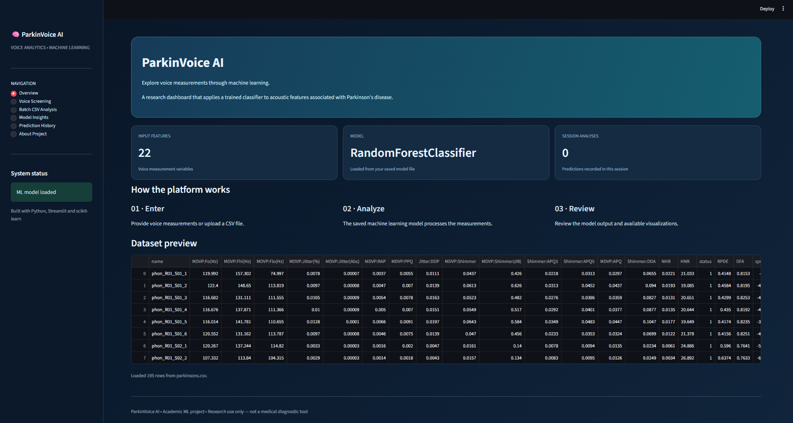
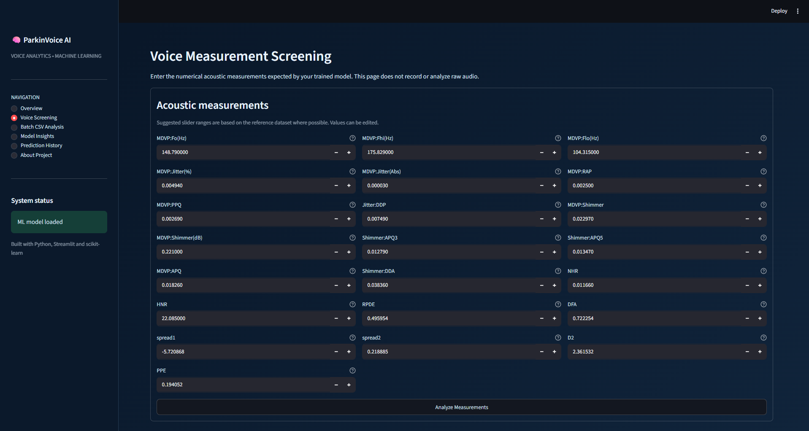
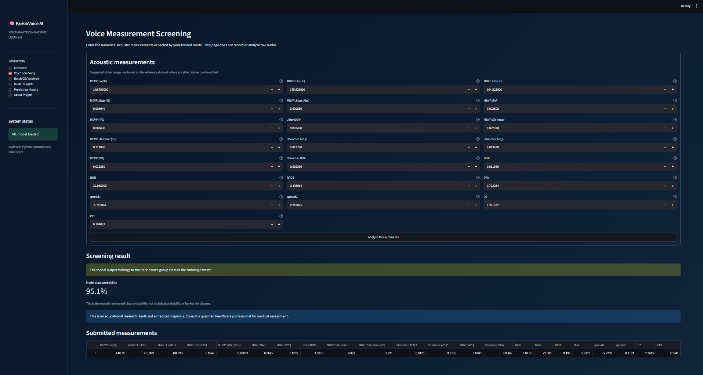
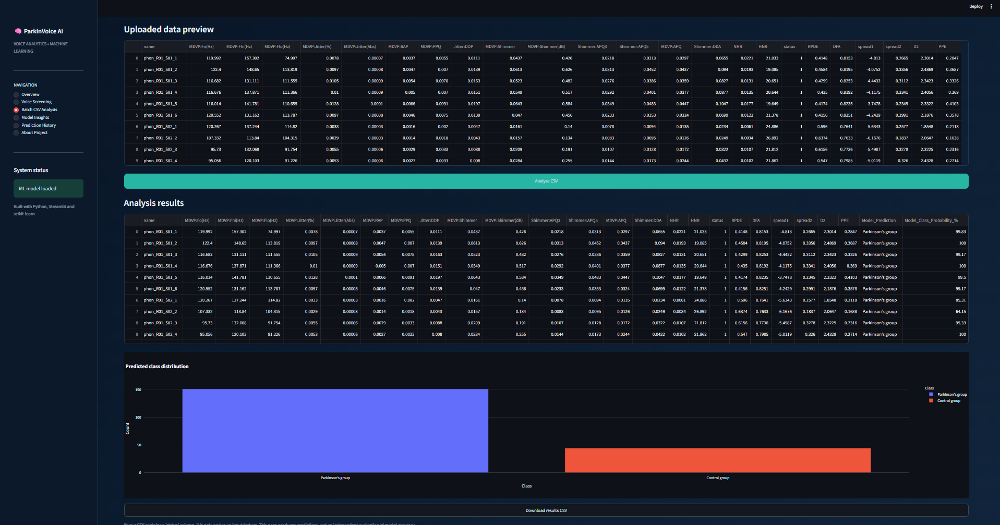
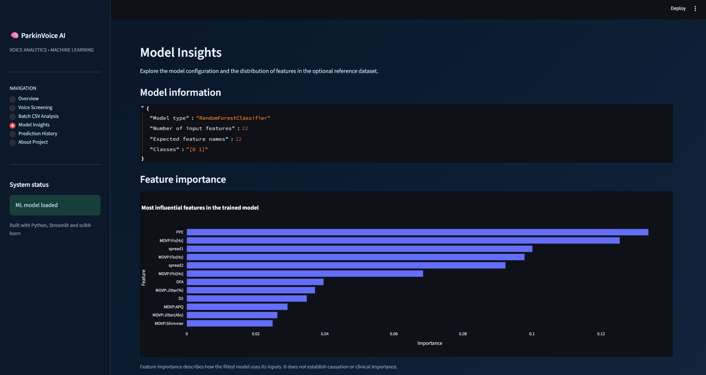
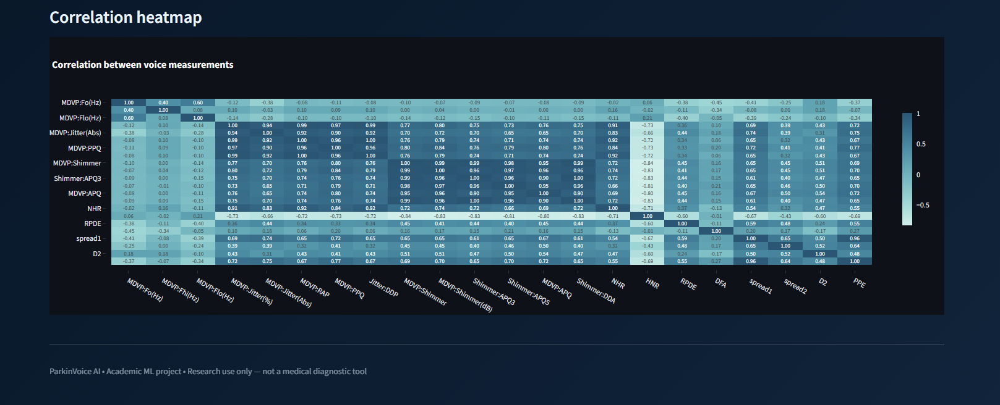

<div align="center">

# 🧠 Parkinson Disease Detection
### Using Machine Learning and Voice Analysis

**your voice says more than you think 🎙️✨**


[✨ TL;DR](#-tldr) · [📸 App Tour](#-app-tour) · [🔬 How It Works](#-how-it-works) · [📈 Results](#-results) · [⚙️ Run It](#️-run-it-locally) · [🧠 What I Learned](#-what-i-learned)

</div>

---

## ✨ TL;DR

| | |
|---|---|
| 🎯 **Goal** | Tell healthy voices apart from Parkinson's voices using 22 acoustic measurements |
| 🧪 **Data** | 195 voice recordings (Oxford / UCI Parkinson's dataset) |
| 🌲 **Final model** | Tuned Random Forest |
| 📊 **Score** | **78.97%** accuracy · **64.31%** balanced accuracy (honest, person-grouped validation) |
| 🖥️ **Bonus** | A full **Streamlit dashboard** called *ParkinVoice AI* |

> ⚠️ **Not a medical tool.** This is a student ML project made for learning. It cannot diagnose, rule out, or guide treatment for Parkinson's disease. Please see a doctor for real health concerns. 💙

---

## 🎙️ Why Voice?

Parkinson's can affect the muscles we use to speak, and the changes show up in tiny ways the human ear can miss:

- 🎵 **Jitter**: pitch that wobbles from one cycle to the next
- 🔊 **Shimmer**: loudness that wobbles
- 🌫️ **HNR / NHR**: how much noise sits on top of the clean tone

Turn those into numbers, feed them to a model, and you get a voice-based classifier. That's this project. 🚀

---

## 📸 App Tour

> _Screenshots of **ParkinVoice AI**, the Streamlit dashboard built on top of the model._

<table>
  <tr>
    <td align="center"><b>🏠 Overview</b><br></td>
    <td align="center"><b>🎙️ Voice Screening</b><br></td>
  </tr>
  <tr>
    <td align="center"><b>✅ Prediction Result</b><br></td>
    <td align="center"><b>📂 Batch CSV Analysis</b><br></td>
  </tr>
  <tr>
    <td align="center"><b>🏆 Feature Importance</b><br></td>
    <td align="center"><b>🔥 Correlation Heatmap</b><br></td>
  </tr>
</table>

| Page | What it does |
|---|---|
| 🏠 **Overview** | Dataset preview and project summary |
| 🎙️ **Voice Screening** | Enter the 22 voice measurements, get a prediction |
| 📂 **Batch CSV Analysis** | Upload a CSV, predict every row, download results |
| 📈 **Model Insights** | Feature importance, distributions, correlation heatmap |
| 🕘 **Prediction History** | Everything you predicted this session |
| ℹ️ **About Project** | Objective, inputs and limitations |

---

## 📊 The Data

**Oxford Parkinson's Disease Detection Dataset** (UCI ML Repository), created by Max Little at the University of Oxford with the National Centre for Voice and Speech.

| | |
|---|---|
| 🎤 Recordings | **195** (about 6 per person) |
| 🔴 Parkinson's group | **147** (75%) |
| 🟢 Healthy controls | **48** (25%) |
| 🔢 Features | **22** acoustic measurements |
| ❓ Missing values | none |

<details>
<summary><b>🎼 See all 22 features (click to expand)</b></summary>

| Group | Features | Meaning |
|---|---|---|
| **Pitch** | `MDVP:Fo`, `MDVP:Fhi`, `MDVP:Flo` | Average, max and min vocal frequency |
| **Jitter** | `MDVP:Jitter(%)`, `Jitter(Abs)`, `RAP`, `PPQ`, `Jitter:DDP` | Pitch variation cycle to cycle |
| **Shimmer** | `MDVP:Shimmer`, `Shimmer(dB)`, `APQ3`, `APQ5`, `MDVP:APQ`, `Shimmer:DDA` | Loudness variation |
| **Noise** | `NHR`, `HNR` | Noise vs. tonal components |
| **Nonlinear** | `RPDE`, `DFA`, `spread1`, `spread2`, `D2`, `PPE` | Complexity and irregularity of the signal |

</details>

---

## 🔬 How It Works

```
 📥 Raw data  ──►  🔍 EDA  ──►  👥 Group by person  ──►  🔁 Grouped 5-fold CV
                                                              │
 🖥️ Streamlit app  ◄──  💾 Saved model  ◄──  🌲 Tuned RF  ◄──  ⚔️ Model showdown
```

1. 🔍 **Explore**: class balance, histograms, correlation matrix, jitter / shimmer / HNR boxplots
2. 👥 **Group by person**: pull the subject ID out of each recording name (`phon_R01_S01_1` → `S01`)
3. 🔁 **Validate properly**: `StratifiedGroupKFold`, so one person's recordings never land in both train and test
4. ⚔️ **Compare and tune**: Decision Tree vs Random Forest (plus SVM and Logistic Regression), then tune the forest
5. 📏 **Evaluate deeply**: precision, recall, F1, confusion matrix and balanced accuracy
6. 🚀 **Ship it**: save with `joblib` and serve through Streamlit

> 💡 **The part I care about most:** each person gives ~6 near-identical recordings. A normal random split leaks them across train and test, which flatters the score. Splitting **by person** gives a number you can actually trust.

---

## 📈 Results

### ⚔️ Model showdown (5-fold grouped CV)

| Model | Accuracy | Precision | Recall | F1 |
|---|---|---|---|---|
| Decision Tree | 78.32% | 84.35% | 87.35% | 85.46% |
| Random Forest (default) | 78.00% | 81.09% | 91.62% | 85.99% |
| **Random Forest (tuned)** 👑 | **79.15%** | 81.36% | 93.35% | 86.84% |

Winner: `RandomForestClassifier(n_estimators=200, max_depth=10, min_samples_leaf=2)`

### 🎯 Final out-of-fold scores (all 195 recordings)

| Metric | Score |
|---|---|
| ✅ Accuracy | **78.97%** |
| ⚖️ Balanced accuracy | **64.31%** |
| 🔴 Parkinson's recall | 93% |
| 🟢 Healthy-control recall | 35% |

### 🕵️ The honest take

The model is **great at catching the Parkinson's group** (93% recall) but **struggles with healthy controls** (35% recall). Why? Only 25% of the data is healthy voices, so the model leans toward predicting "Parkinson's". I report **balanced accuracy** next to plain accuracy so that weakness is visible instead of hidden. 🔍

### 🏆 Top features

| Rank | Feature | Importance |
|---|---|---|
| 🥇 | `PPE` | 0.151 |
| 🥈 | `spread1` | 0.109 |
| 🥉 | `MDVP:Fo(Hz)` | 0.079 |
| 4 | `spread2` | 0.066 |
| 5 | `MDVP:Flo(Hz)` | 0.064 |

---

## 📁 Project Structure

```
ParkinVoice-AI/
├── 📱 app.py                   # Streamlit dashboard (ParkinVoice AI)
├── 📓 main.ipynb               # EDA, models, tuning, saving the model
├── 🐍 parkinson_main_file.py   # Script version of the modelling workflow
├── 🤖 parkinsons_model.pkl     # Trained Random Forest used by the app
├── 📊 parkinsons.csv           # Dataset
├── 📊 parkinsons.data          # Original UCI data file
├── 📝 parkinsons.names         # Original dataset description
├── 🖼️ images/                  # App screenshots shown in this README
├── 📦 requirements.txt         # Dependencies
└── 📖 README.md
```

---

## ⚙️ Run It Locally

```bash
# 1. Clone
git clone https://github.com/akapranshu2-boop/ParkinVoice-AI.git
cd ParkinVoice-AI

# 2. Virtual environment (recommended)
python -m venv venv
venv\Scripts\activate          # Windows
# source venv/bin/activate     # macOS / Linux

# 3. Install
pip install -r requirements.txt

# 4. Launch the app 🚀
streamlit run app.py
```

Opens at `http://localhost:8501`.

**Want to explore the analysis?**

```bash
pip install matplotlib seaborn jupyter
jupyter notebook main.ipynb       # full walkthrough
python parkinson_main_file.py     # script version
```

> 📌 `parkinsons_model.pkl` is saved by the last cell of `main.ipynb`. `requirements.txt` pins the scikit-learn version the model was saved with so it loads cleanly.

---

## 🛠️ Tech Stack

| | |
|---|---|
| 🐍 Language | Python |
| 🧮 Data | pandas, NumPy |
| 🤖 ML | scikit-learn, joblib |
| 📊 Visualisation | Matplotlib, Seaborn, Plotly |
| 🖥️ App | Streamlit |

---

## 🧠 What I Learned

- 🚫 **Data leakage is sneaky.** Multiple recordings per person can quietly inflate results, so I validated by person.
- ⚖️ **Accuracy can lie.** With 75/25 classes, balanced accuracy and per-class recall told the real story.
- 🔄 **Reproducibility matters.** Pinning library versions keeps a saved model loadable.
- 🧩 **ML is more than a notebook.** Turning a model into a usable app taught me about inputs, validation and clear communication of limits.

## ⚠️ Limitations

- 📉 Small dataset: 195 recordings from about 32 people
- ⚖️ Class imbalance means healthy voices are often misclassified
- 🎙️ The app takes pre-computed measurements, **not raw audio**
- 🏥 Not clinically validated

## 🔮 What's Next

- [ ] Extract the 22 features straight from uploaded audio (Praat / Parselmouth)
- [ ] Fix class imbalance (SMOTE, threshold tuning)
- [ ] Try XGBoost / LightGBM
- [ ] Add SHAP explanations per prediction
- [ ] Validate on a larger independent dataset

---

## 📚 References

- Little, M.A., McSharry, P.E., Hunter, E.J., Ramig, L.O. (2008). *Suitability of dysphonia measurements for telemonitoring of Parkinson's disease.* IEEE Transactions on Biomedical Engineering.
- [UCI Machine Learning Repository: Parkinsons](https://archive.ics.uci.edu/dataset/174/parkinsons)

---

<div align="center">

## 👋 Made by **Pranshu Dhankhola**

[](https://github.com/akapranshu2-boop)
[](www.linkedin.com/in/pranshu-dhankhola-26a4122a2)

⭐ **If this helped or impressed you, drop a star!** ⭐

</div>
